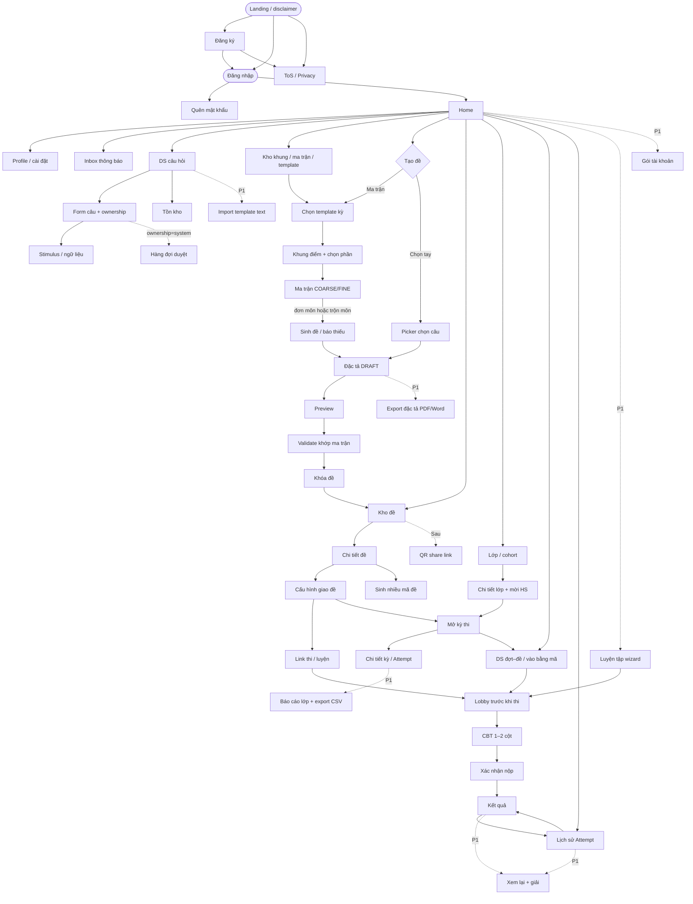
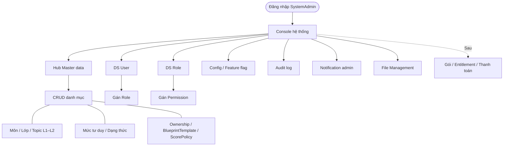

# 13 — Luồng màn hình & chức năng chính

> v1.1 · Hình dung sản phẩm (chưa có UI trong `src/`)  
> Trọng tâm: **một bộ màn hình dùng chung** + quan hệ điều hướng. Role chỉ quyết định *ai vào được nhánh nào*, **không duplicate page**. Chi tiết rule: `01`–`09`, pháp lý `12`.  
> v1.1 bổ sung bước/option đã chốt nhưng dễ miss khi implement (template kỳ, COARSE/FINE, trộn môn, ownership, stimulus, validate khóa, trang pháp lý).

---

## 1. Không gian sản phẩm

| Tầng | Việc chính |
|------|------------|
| Nghiệp vụ | Bank câu (+ stimulus) → tạo đề (template kỳ → khung điểm → ma trận COARSE/FINE / chọn tay; có thể trộn môn) → đặc tả → validate → khóa → kho đề → cấu hình giao → link / kỳ thi → lobby → CBT → kết quả / lịch sử; (P1) luyện tập, import, báo cáo, export đặc tả |
| Nền tảng | Master data, user/role, config, audit, notification, file, (sau) gói & thanh toán |
| Tài khoản | Đăng ký / đăng nhập / quên MK / profile; ToS / Privacy; inbox thông báo; (khi thu tiền) gói |

**Ai dùng gì (permission, không tách app):**

| Nhánh màn | Ai vào (MVP) |
|-----------|----------------|
| Bank câu, tồn kho, form câu (+ stimulus), import *(P1)* | GV (+ HS sau nếu gói cho phép) |
| Tạo đề → kho đề → share link | **HS + GV** (cùng màn) |
| Kho khung điểm / ma trận / template tái dùng | HS + GV |
| Lớp / mời HS / kỳ thi / báo cáo lớp | GV |
| Luyện tập, lịch sử Attempt, inbox | **HS + GV** |
| Duyệt câu hệ thống | ContentAdmin |
| Console hệ thống | SystemAdmin |
| Gói tài khoản | User đã login (khi bật paywall) |

**Role giai đoạn đầu (`04`):** Teacher ≈ ContentAdmin được. **CenterAdmin** (quản user/gói trung tâm) **gộp Teacher** lúc MVP — chưa tách nhánh màn; khi có org thật mới thêm `/app/org/…`. Không bỏ entity/permission trong model.

Hai cách tạo đề: **ma trận** (có thể từ template kỳ / trộn môn) hoặc **chọn tay** → đặc tả → **validate** → khóa → **Kho đề** → cấu hình giao → link. Paywall siết **quota**, không cắt pipeline tạo đề.

**Không đưa vào flow (tham khảo đối thủ, lệch core):** LMS / khóa học / bảng tin lớp, video bài giảng, OCR–AI parse PDF, thi offline tô phiếu, certificate, proctoring ML / giám sát camera, ExamSession ca/phòng *(optional — chưa cần màn)*.

---

## 2. Sơ đồ luồng màn hình

### 2.1 Nghiệp vụ — một đồ thị màn



**Quan hệ cần nhớ**

| Từ | → | Ý nghĩa |
|----|---|--------|
| Landing | Đăng ký / Đăng nhập / ToS·Privacy | Công khai; disclaimer không gắn Bộ (`12`); footer link pháp lý |
| Home | Bank / Tạo đề / Kho / Đợt / Lớp / Lịch sử / Luyện / Inbox / Gói | Hub — widget theo permission (HS: đợt mở + lịch sử; GV: tồn kho thiếu + kỳ đang chạy) |
| Tạo đề (ma trận) | **Chọn template kỳ** → Khung (+ chọn phần) → Ma trận (**COARSE/FINE**; đơn môn hoặc **trộn môn**) → Sinh đề | Template đổ sẵn khung/điểm (`TN_THPT_*`, kiểm tra, `DGNL_MIX_*`…); user sửa được trước khi vào ô |
| Tạo đề (chọn tay) | Picker | Cùng Đặc tả; không bắt buộc qua ma trận |
| Đặc tả | Preview → **Validate** → Khóa | Validate khớp số câu/mức/format từng ô; fail thì không khóa (`09`) |
| Khóa đề | Kho đề | Snapshot cố định mới cấu hình giao / mở kỳ được |
| Chi tiết đề | Cấu hình giao → Link **và/hoặc** Kỳ thi | Link đủ cá nhân; kỳ thi cho lớp (GV); tuỳ chọn sinh thêm mã đề |
| Cấu hình giao | Timer, cửa sổ mở–đóng, số lượt, công bố điểm/đáp án, **xáo câu theo khối stimulus + xáo A–D** | Bắt buộc trước khi share / mở kỳ |
| Lobby | CBT | Màn “trước khi vào thi”: thông tin đề + thời gian + Bắt đầu |
| Link / Kỳ / Luyện | Cùng CBT | Mode luyện có thể hiện giải sớm hơn (P1); CBT **2 cột** khi có stimulus |
| Lớp | Chi tiết lớp + mã/link/QR mời | HS join rồi mới nhận kỳ giao theo lớp |
| Form câu | Ownership + Stimulus | `personal`/`center` dùng nội bộ; nộp `system` → hàng đợi duyệt; ngữ liệu dùng chung gắn bundle |
| Kho đề | QR *(sau)* | Share nhanh, không màn riêng theo role |

### 2.2 Nền tảng



---

## 3. Catalogue màn (mỗi màn một lần)

### 3.1 Tài khoản & hub

| Màn | Mục đích | Vào từ | Ưu tiên |
|-----|----------|--------|---------|
| Landing / disclaimer | Giới thiệu ngắn + disclaimer độc lập Bộ; footer → ToS / Privacy | — | P0 |
| Điều khoản (ToS) | Upload / sử dụng; GV tự chịu trách nhiệm bản quyền câu | Landing; Đăng ký | P0 |
| Chính sách bảo mật | Thu thập / xử lý dữ liệu HS (`12`) | Landing; Đăng ký | P0 |
| Đăng ký | Email + password; checkbox đồng ý ToS; **đồng ý phụ huynh** khi cần | Landing | P0 |
| Đăng nhập | Vào hệ thống | Landing; sau đăng ký | P0 |
| Quên mật khẩu | Reset qua email | Đăng nhập | P0 |
| Profile / cài đặt | Đổi MK, thông tin cơ bản, (sau) ngôn ngữ | Home | P0 |
| Home | Hub theo permission | Login | P0 |
| Inbox thông báo | Giao đề, hết hạn, công bố điểm… | Home | P1 |
| Báo cáo bản quyền *(nhẹ)* | Notice & takedown (`12`) | Footer / Help | P1 trước public |

### 3.2 Bank câu

| Màn | Mục đích | Vào từ | Ưu tiên |
|-----|----------|--------|---------|
| DS câu hỏi | Quản lý bank; lọc môn / topic / mức / format / ownership | Home | P0 |
| Form câu | Nhập / sửa **MCQ · Đ/S · Short**; metadata bắt buộc; **ownership** (`personal` / `center` / nộp `system`); gắn **Stimulus** nếu có; LaTeX; cảnh báo trùng stem (nhẹ) | DS câu hỏi | P0 |
| Stimulus / ngữ liệu | Tạo / sửa đoạn văn · hình · bảng dùng chung nhiều câu; không tính điểm riêng | Form câu; DS câu *(filter bundle)* | P0 *(cùng form hoặc panel — không bắt buộc route riêng)* |
| Tồn kho | Đủ/thiếu theo topic × mức × format (**Đ/S đếm theo câu**) | DS câu hỏi; Ma trận (realtime theo ô) | P0 |
| Import template text | Nhập hàng loạt từ template | DS câu hỏi | P1 |
| Hàng đợi duyệt | Approve / Reject vào bank hệ thống (stem + đáp án + metadata) | Form (nộp system); Home (ContentAdmin) | P0 |

### 3.3 Tạo đề → kho đề

| Màn | Mục đích | Vào từ | Ưu tiên |
|-----|----------|--------|---------|
| Kho khung / ma trận / template | DS BlueprintTemplate + khung/ma trận đã lưu; nhân bản / tái dùng | Home; khi tạo đề | P1 *(template hệ thống seed sẵn từ P0)* |
| **Chọn template kỳ** | Chọn `TN_THPT_*` / kiểm tra / **`DGNL_MIX_*` (trộn môn)** / trống → đổ khung + score policy | Tạo đề (nhánh ma trận); kho template | P0 |
| Khung điểm | Số phần + cách tính + tổng điểm từng phần; **chọn phần đưa vào đề**; phần Đ/S: % theo số ý đúng | Sau template; kho khung | P0 |
| Ma trận | Ô bốc: chủ đề × mức × dạng (+ môn nếu trộn); toggle **COARSE / FINE**; tồn kho realtime theo ô | Khung điểm | P0 |
| Sinh đề / báo thiếu | Bốc; thiếu thì **ShortageReport theo ô/môn**, không sinh cụt; lấy cả **bundle stimulus** | Ma trận | P0 |
| Picker chọn câu | Chọn tay từ bank (fixed exam); tôn trọng ownership được phép | Home → Tạo đề | P0 |
| Đặc tả DRAFT | Review / đổi câu cùng ô / reorder / sửa YCCĐ; toggle xem **4 mức / gộp 3 mức (VDC→VD)** | Sinh đề hoặc Picker | P0 |
| Preview | Soi mắt thí sinh (GV); HS **không** làm bản chưa khóa | Đặc tả | P0 |
| Validate → Khóa đề | Kiểm khớp ma trận (số câu/mức/format từng ô) → snapshot; fail → ở lại Đặc tả | Preview / Đặc tả | P0 |
| Export đặc tả PDF/Word | Hồ sơ trường / CV 7991-style | Đặc tả; Chi tiết đề | P1 |
| **Kho đề** | DS đề đã tạo; copy link; (sau) QR; filter ownership | Home; sau Khóa đề | P0 |
| Chi tiết đề | Xem / nhân bản / mở cấu hình giao / mở kỳ; ownership đề | Kho đề | P0 |
| Sinh nhiều mã đề | Tạo ExamVersion 2, 3… từ cùng ma trận / đề gốc (chống quay cóp có chủ đích) | Chi tiết đề | P1 |
| QR share *(sau)* | QR trỏ cùng link | Kho đề / Chi tiết đề | Sau |

### 3.4 Giao đề, lớp, làm bài

| Màn | Mục đích | Vào từ | Ưu tiên |
|-----|----------|--------|---------|
| Cấu hình giao đề | Timer, cửa sổ mở–đóng, số lượt, công bố điểm/đáp án, **xáo câu theo khối stimulus + xáo A–D** (MCQ) | Chi tiết đề | P0 |
| Link thi / luyện | URL dùng chung cho Attempt (sau khi cấu hình) — **cùng ExamVersion = cùng đề** | Cấu hình giao | P0 |
| Kỳ thi | Thời gian mở; gắn đề + lớp | Cấu hình giao; Chi tiết lớp | P0 |
| Chi tiết kỳ | Ai đã làm, điểm; (P1) theo dõi realtime nhẹ | Kỳ thi | P0 |
| Lớp / cohort | DS lớp của GV | Home | P0 |
| Chi tiết lớp + mời HS | DS thành viên; mã / link / QR join | Lớp | P0 |
| Join lớp *(HS)* | Nhập mã hoặc mở link/QR mời | Link mời; Home | P0 |
| Báo cáo lớp *(P1)* | Tổng hợp điểm; % đúng theo câu/ô; toggle 3 mức nếu cần; **export Excel** | Chi tiết kỳ | P1 |
| DS đợt–đề / mã | Chọn bài được mở hoặc nhập mã | Home; Kỳ thi | P0 |
| Lobby trước khi thi | Thông tin đề, thời gian, quy định → Bắt đầu | DS đợt; Link; Luyện | P0 |
| Luyện tập wizard *(P1)* | Chọn môn / chủ đề × số câu → sinh on-the-fly | Home | P1 |
| CBT | Timer, palette, trả lời, autosave; **1 cột hoặc 2 cột (stimulus \| câu)**; *(P1)* log **tab blur** cảnh báo nhẹ | Lobby | P0 |
| Xác nhận nộp | Tránh nộp nhầm | CBT | P0 |
| Kết quả | Điểm sau chấm máy (score policy khung) | Nộp | P0 |
| Lịch sử Attempt | DS bài đã làm → kết quả / xem lại | Home; sau Kết quả | P0 |
| Xem lại + giải *(P1)* | Ôn; có thể gắn entitlement | Kết quả; Lịch sử | P1 |
| Gói tài khoản *(khi thu tiền)* | Quota / chọn gói / thanh toán; (sau) trang hoàn tiền | Home; chạm hạn mức | Khi thu tiền |

---

## 4. Gói tài khoản *(nháp — thiết kế trước, thu tiền sau)*

> Nền tảng + bank ổn → có user → mới siết quota / thu tiền (`01` §6.4). Pháp lý: `12`.

| Gói | Giá (nháp) | Chu kỳ | Quota gợi ý |
|-----|------------|--------|-------------|
| **Free** | 0 | — | ~5 đề khóa / tháng; thi đề được share; kết quả cơ bản |
| **Cơ bản** | ~49–79k / tháng hoặc ~399–599k / năm | Tháng hoặc năm | ~30–50 đề / tháng; xem lại + giải |
| **Pro** *(sau)* | Cao hơn | Tháng / năm | Quota cao; bank cá nhân |

Gói GV / trung tâm (số câu, số đề, số HS, số kỳ): outline sau — cùng màn Gói, khác Plan code. **CenterAdmin UI** khi có org: cùng schema Plan, khác permission.

**Backlog không quên:** schema Plan / Entitlement / usage counter sớm; UI + cổng thanh toán khi traffic ổn; đồng ý phụ huynh trước bán gói HS; **QR share từ Kho đề**; trang hoàn tiền / hủy gói khi thu tiền.

---

## 5. Màn hình nền tảng

| Màn | Mục đích |
|-----|----------|
| Console admin | Vào tầng hệ thống |
| Hub Master data | Trỏ từng danh mục |
| CRUD master | Môn, lớp, Topic L1/L2, mức tư duy, dạng thức, ownership, **BlueprintTemplate**, ScorePolicy… |
| DS User + gán Role | Tài khoản / vai trò |
| DS Role + gán Permission | Phân quyền |
| Config / feature flag | Đổi hành vi (kể cả paywall) không redeploy |
| Audit log | Ai làm gì, trên entity nào |
| Notification admin | Banner hệ thống / broadcast / cấu hình kênh email… |
| File Management | Upload stem / media / export |
| Gói / thanh toán *(sau)* | Plan, entitlement, đối soát |

> Inbox thông báo **user** (mục 3.1) khác Notification admin: một bên là chuông cho HS/GV, một bên là vận hành hệ thống.

---

## 6. Sitemap gọn *(route theo domain, không nhân đôi theo role)*

```
/                           ← landing + disclaimer
/terms                      ← ToS
/privacy                    ← chính sách bảo mật
/login
/register
/forgot-password

/app/…              home
                    profile
                    inbox                    ← thông báo user (P1)
                    questions, questions/:id ← form + ownership + gắn stimulus
                    questions/import         ← P1
                    score-frames | blueprints ← kho khung / ma trận / template (P1 list)
                    exams                    ← Kho đề
                    exams/new                ← chọn ma trận | fixed
                    exams/new/matrix         ← template kỳ → khung (+phần) → COARSE|FINE → sinh
                                              (đơn môn hoặc trộn môn / ĐGNL)
                    exams/new/fixed          ← picker
                    exams/:id                ← đặc tả / preview / validate+khóa
                    exams/:id/export         ← đặc tả PDF/Word (P1)
                    exams/:id/delivery       ← cấu hình giao / link / kỳ
                    exams/:id/variants       ← sinh nhiều mã đề (P1)
                    campaigns, campaigns/:id
                    classes, classes/:id     ← chi tiết + mời
                    classes/join             ← HS nhập mã
                    practice/new             ← luyện (P1)
                    attempts                 ← lịch sử
                    attempts/:id             ← lobby / CBT / kết quả / xem lại
                    plans                    ← gói (khi bật)
                    report-content           ← báo cáo bản quyền (P1)

/content/…          review-queue

/system/…           master-data, users, roles, config,
                    audit-logs, notifications, files, (billing)
```

Menu Home ẩn/hiện mục theo permission — **không** `/student/exams/new` vs `/teacher/exams/new`.  
Stimulus: entity gắn trong `questions/:id` (panel), không bắt buộc `/stimuli` riêng trừ khi list bundle phình to.

---

## 7. Checklist implement — đừng miss trên UI

Các điểm đã chốt ở `03`/`06`/`07`/`09`/`12` nhưng dễ sót nếu chỉ nhìn đồ thị cũ:

| # | Việc trên UI | Màn |
|---|--------------|-----|
| 1 | Chọn **BlueprintTemplate** trước khi sửa khung | `exams/new/matrix` |
| 2 | Toggle **COARSE / FINE** | Ma trận |
| 3 | **Chọn phần** đưa vào đề | Khung điểm |
| 4 | Ô / section có **`subject_id`** → đề **trộn môn** | Ma trận |
| 5 | Shortage **theo ô (và môn)**; không sinh cụt | Sinh đề |
| 6 | Bundle **stimulus** không bị tách khi bốc / xáo | Sinh đề; Cấu hình giao; CBT |
| 7 | **Validate** khớp ma trận trước **Khóa** | Đặc tả / Khóa |
| 8 | Field **ownership** trên câu (và đề); nộp system → review | Form câu; Chi tiết đề |
| 9 | CBT **2 cột** khi có ngữ liệu | CBT |
| 10 | Xáo câu theo **khối**; xáo A–D chỉ MCQ | Cấu hình giao / lúc phát đề |
| 11 | ToS / Privacy / disclaimer / (khi cần) đồng ý phụ huynh | Landing; Đăng ký |
| 12 | *(P1)* Export đặc tả; tab blur log; báo cáo 3 mức; báo cáo bản quyền | Đặc tả; CBT; Báo cáo; Footer |

---

## 8. Không làm phức tạp sớm

Proctoring ML, ranking/meme nặng, AI parse PDF / OCR, tự luận Văn, audio, IAM enterprise, microservices, LMS / khóa học / bảng tin lớp, thi offline tô phiếu, certificate, màn CenterAdmin / org tách riêng, ExamSession ca/phòng.  
Thu tiền / QR: sau nền tảng ổn — entitlement thiết kế sẵn.
