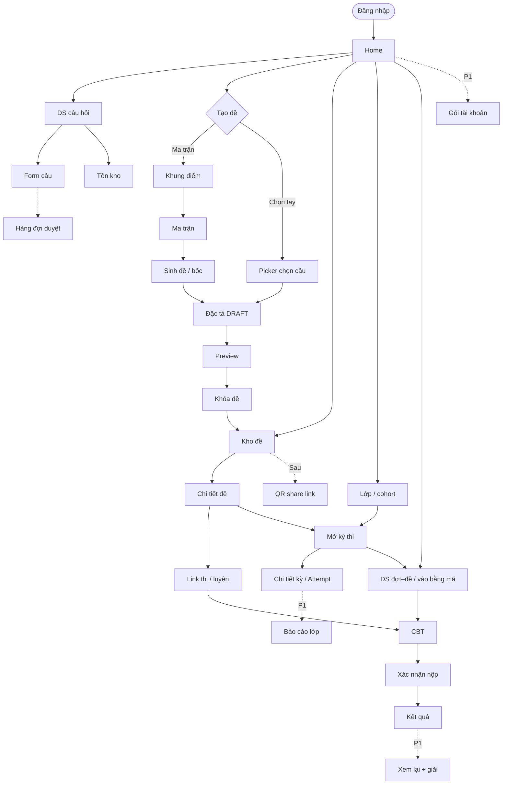

# 13 — Luồng màn hình & chức năng chính

> v0.9 · Hình dung sản phẩm (chưa có UI trong `src/`)  
> Trọng tâm: **một bộ màn hình dùng chung** + quan hệ điều hướng. Role chỉ quyết định *ai vào được nhánh nào*, **không duplicate page**. Chi tiết rule: `01`–`09`.

---

## 1. Không gian sản phẩm

| Tầng | Việc chính |
|------|------------|
| Nghiệp vụ | Bank câu → tạo đề (khung điểm / ma trận / chọn tay) → kho đề → link / kỳ thi → CBT → kết quả |
| Nền tảng | Master data, user/role, config, audit, notification, file, (sau) gói & thanh toán |

**Ai dùng gì (permission, không tách app):**

| Nhánh màn | Ai vào (MVP) |
|-----------|----------------|
| Bank câu, tồn kho, form câu | GV (+ HS sau nếu gói cho phép) |
| Tạo đề → kho đề → share link | **HS + GV** (cùng màn) |
| Lớp / kỳ thi / báo cáo lớp | GV |
| Duyệt câu hệ thống | ContentAdmin |
| Console hệ thống | SystemAdmin |
| Gói tài khoản | User đã login (khi bật paywall) |

Hai cách tạo đề: **ma trận** hoặc **chọn tay** → khóa → **Kho đề** → link. Paywall siết **quota**, không cắt pipeline tạo đề.

---

## 2. Sơ đồ luồng màn hình

### 2.1 Nghiệp vụ — một đồ thị màn



**Quan hệ cần nhớ**

| Từ | → | Ý nghĩa |
|----|---|--------|
| Home | Bank / Tạo đề / Kho đề / DS đợt / Lớp / Gói | Hub — hiện mục theo permission |
| Tạo đề | Khung điểm → Ma trận → Sinh đề **hoặc** Picker | Hai đường vào cùng Đặc tả |
| Khóa đề | Kho đề | Đề cố định mới share / mở kỳ được |
| Chi tiết đề | Link thi **và/hoặc** Mở kỳ thi | Link đủ cho cá nhân; kỳ thi cho lớp (GV) |
| Link / Kỳ thi | CBT | Cùng màn làm bài |
| Kho đề | QR *(sau)* | Share nhanh, không màn riêng theo role |

### 2.2 Nền tảng


---

## 3. Catalogue màn (mỗi màn một lần)

| Màn | Mục đích | Vào từ |
|-----|----------|--------|
| Đăng nhập | Vào hệ thống | — |
| Home | Hub theo permission | Login |
| DS câu hỏi | Quản lý bank | Home |
| Form câu | Nhập / sửa MCQ · Đ/S · Short | DS câu hỏi |
| Tồn kho | Đủ/thiếu theo topic × mức × format | DS câu hỏi |
| Hàng đợi duyệt | Approve / Reject vào bank hệ thống | Form câu / Home (ContentAdmin) |
| Khung điểm | Số phần + cách tính điểm | Home → Tạo đề |
| Ma trận | Quy tắc bốc theo ô (chủ đề × mức × dạng) | Khung điểm |
| Sinh đề / báo thiếu | Bốc; thiếu thì không sinh cụt | Ma trận |
| Picker chọn câu | Chọn tay từ bank | Home → Tạo đề |
| Đặc tả DRAFT | Review / đổi câu / xáo trước khóa | Sinh đề hoặc Picker |
| Preview | Soi mắt thí sinh | Đặc tả |
| Khóa đề | Snapshot cố định | Preview |
| **Kho đề** | DS đề đã tạo; copy link; (sau) QR | Home; sau Khóa đề |
| Chi tiết đề | Xem / nhân bản / mở link / mở kỳ | Kho đề |
| Link thi / luyện | URL dùng chung cho Attempt | Chi tiết đề |
| QR share *(sau)* | QR trỏ cùng link | Kho đề / Chi tiết đề |
| Kỳ thi | Thời gian mở; gắn đề + lớp | Chi tiết đề; Lớp |
| Chi tiết kỳ | Ai đã làm, điểm | Kỳ thi |
| Lớp / cohort | Gắn HS vào lớp | Home |
| Báo cáo lớp *(P1)* | Tổng hợp điểm | Chi tiết kỳ |
| DS đợt–đề / mã | Chọn bài được mở hoặc nhập mã | Home; Kỳ thi |
| CBT | Timer, palette, trả lời, autosave | DS đợt; Link |
| Xác nhận nộp | Tránh nộp nhầm | CBT |
| Kết quả | Điểm sau chấm máy | Nộp |
| Xem lại + giải *(P1)* | Ôn; có thể gắn entitlement | Kết quả |
| Gói tài khoản *(khi thu tiền)* | Quota / chọn gói / thanh toán | Home; chạm hạn mức |

---

## 4. Gói tài khoản *(nháp — thiết kế trước, thu tiền sau)*

> Nền tảng + bank ổn → có user → mới siết quota / thu tiền (`01` §6.4). Pháp lý: `12`.

| Gói | Giá (nháp) | Chu kỳ | Quota gợi ý |
|-----|------------|--------|-------------|
| **Free** | 0 | — | ~5 đề khóa / tháng; thi đề được share; kết quả cơ bản |
| **Cơ bản** | ~49–79k / tháng hoặc ~399–599k / năm | Tháng hoặc năm | ~30–50 đề / tháng; xem lại + giải |
| **Pro** *(sau)* | Cao hơn | Tháng / năm | Quota cao; bank cá nhân |

Gói GV / trung tâm (số câu, số đề, số HS, số kỳ): outline sau — cùng màn Gói, khác Plan code.

**Backlog không quên:** schema Plan / Entitlement / usage counter sớm; UI + cổng thanh toán khi traffic ổn; đồng ý phụ huynh trước bán gói HS; **QR share từ Kho đề**.

---

## 5. Màn hình nền tảng

| Màn | Mục đích |
|-----|----------|
| Console admin | Vào tầng hệ thống |
| Hub Master data | Trỏ từng danh mục |
| CRUD master | Môn, lớp, Topic, mức tư duy, dạng thức, ownership, template điểm… |
| DS User + gán Role | Tài khoản / vai trò |
| DS Role + gán Permission | Phân quyền |
| Config / feature flag | Đổi hành vi (kể cả paywall) không redeploy |
| Audit log | Ai làm gì, trên entity nào |
| Notification | Banner / in-app / email… |
| File Management | Upload stem / media / export |
| Gói / thanh toán *(sau)* | Plan, entitlement, đối soát |

---

## 6. Sitemap gọn *(route theo domain, không nhân đôi theo role)*

```
/login
/app/…              home
                    questions, questions/:id
                    exams                    ← Kho đề
                    exams/new/matrix | new/fixed
                    exams/:id                ← chi tiết / preview / khóa
                    campaigns, classes
                    attempts/:id             ← CBT / kết quả / xem lại
                    plans                    ← gói (khi bật)
/content/…          review-queue
/system/…           master-data, users, roles, config,
                    audit-logs, notifications, files, (billing)
```

Menu Home ẩn/hiện mục theo permission — **không** `/student/exams/new` vs `/teacher/exams/new`.

---

## 7. Không làm phức tạp sớm

Proctoring ML, ranking/meme nặng, AI parse PDF, tự luận Văn, audio, IAM enterprise, microservices.  
Thu tiền / QR: sau nền tảng ổn — entitlement thiết kế sẵn.
