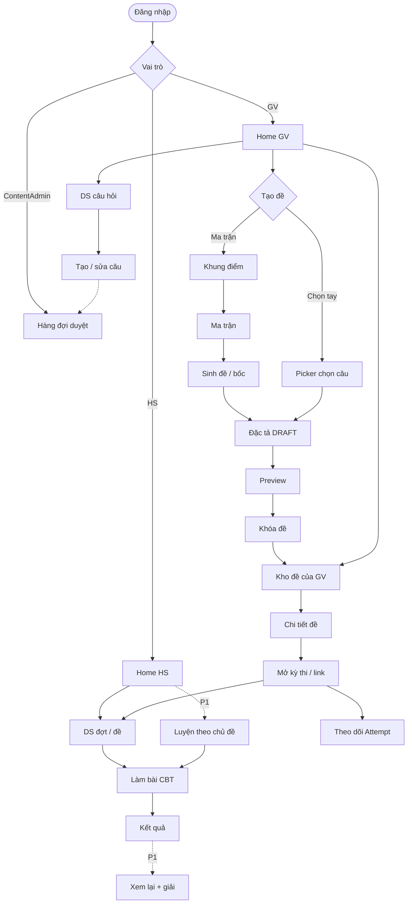
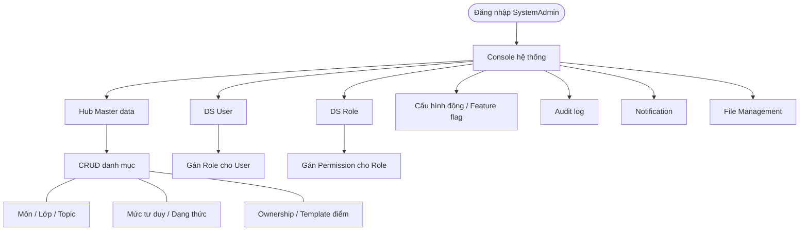

# 13 — Luồng màn hình & chức năng chính

> v0.7 · Hình dung sản phẩm (chưa có UI trong `src/`)  
> Trọng tâm: **2 sơ đồ luồng** + màn/mục đích. Chi tiết rule xem `01`–`09`.

---

## 1. Không gian sản phẩm

| Tầng | Ai | Việc chính |
|------|-----|------------|
| Nghiệp vụ | Học sinh | Thi CBT / luyện → xem điểm |
| Nghiệp vụ | Giáo viên | Bank câu → tạo đề → kho đề → mở kỳ thi |
| Nghiệp vụ | ContentAdmin | Duyệt câu vào bank hệ thống |
| Nền tảng | SystemAdmin | Master data, user/role, config, audit log, notification, file |

**Hai cách tạo đề (ngang nhau):** ma trận (bốc 1 lần, vẫn đổi câu được) **hoặc** chọn tay từng câu. Sau khóa → cùng **Kho đề** → cùng link cho cả lớp.

---

## 2. Sơ đồ luồng

### 2.1 Nghiệp vụ (thi / bank / đề)



### 2.2 Nền tảng (master data / RBAC / config / log / notification / file)



---

## 3. Màn hình nghiệp vụ

### Học sinh

| Màn | Mục đích |
|-----|----------|
| Đăng nhập | Vào hệ thống |
| Home HS | Thấy đợt/đề được mở |
| DS đợt–đề / vào bằng mã | Chọn bài thi |
| CBT | Timer, palette, trả lời, autosave |
| Xác nhận nộp | Tránh nộp nhầm |
| Kết quả | Điểm sau chấm máy |
| Xem lại + giải | Ôn (P1) |
| Luyện theo chủ đề | Chọn phạm vi ôn, CBT mode luyện (P1) |

### Giáo viên — bank

| Màn | Mục đích |
|-----|----------|
| Home GV | Hub: Bank / Kho đề / Tạo đề / Kỳ thi |
| DS câu hỏi | Quản lý bank |
| Form câu (MCQ / Đ/S / Short) | Nhập nội dung + metadata |
| Tồn kho | Đủ/thiếu theo topic × mức × format |
| Hàng đợi duyệt *(ContentAdmin)* | Approve / Reject vào bank system |

### Giáo viên — đề & kỳ thi

| Màn | Mục đích |
|-----|----------|
| Khung bài thi | Số phần + cách tính điểm |
| Ma trận / DS Blueprint | Quy tắc bốc theo ô |
| Sinh đề / báo thiếu | Bốc theo ô; thiếu thì không sinh cụt |
| Picker chọn câu | Chọn tay từ bank, không random |
| Đặc tả DRAFT | Review / đổi câu / xáo trước khóa |
| Preview | Soi mắt thí sinh |
| Khóa đề | Snapshot cố định |
| **Kho đề** | Quản lý mọi đề đã tạo; copy link; mở kỳ |
| Chi tiết đề | Xem đề; mở thi / nhân bản |
| Kỳ thi (Campaign) | Thời gian mở; link chung cả lớp |
| Chi tiết kỳ | Ai đã làm, điểm |
| Lớp / cohort | Gắn HS (P0–P1) |
| Báo cáo lớp | Tổng hợp điểm (P1) |

---

## 4. Màn hình nền tảng

| Màn | Mục đích |
|-----|----------|
| Console admin | Điểm vào tầng hệ thống |
| Hub Master data | Trỏ tới từng loại danh mục |
| CRUD master | Môn, lớp, Topic, mức tư duy, dạng thức, ownership, template điểm… |
| DS User + gán Role | Quản trị tài khoản / vai trò |
| DS Role + gán Permission | Phân quyền đơn giản |
| Config / feature flag | Đổi hành vi không redeploy |
| Audit log | Ai làm gì, trên entity nào |
| Notification | Template / gửi thông báo hệ thống (banner, in-app, email…) |
| File Management | Quản lý file đã upload (ảnh stem, media, export…); xem / xóa / giới hạn |

---

## 5. Sitemap gọn

```
/login
/student/…          home, đợt–đề, CBT, kết quả, (luyện)
/teacher/…          home, questions, exams ← Kho đề,
                    exams/new/matrix | new/fixed, picker,
                    blueprints, campaigns, classes
/content/…          review-queue
/system/…           master-data, users, roles, config, audit-logs,
                    notifications, files
```

---

## 6. Không làm phức tạp sớm

Proctoring ML, ranking/meme nặng, AI parse PDF, tự luận Văn, audio, IAM enterprise, microservices.
