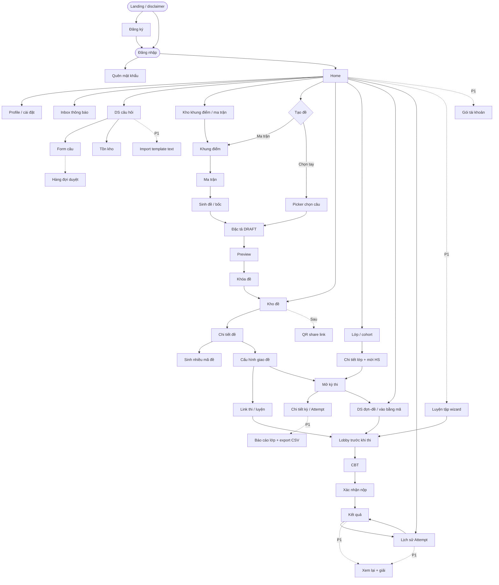
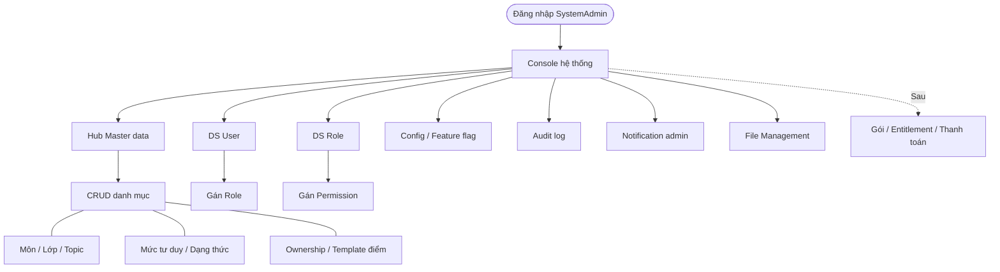

# 13 — Luồng màn hình & chức năng chính

> v1.0 · Hình dung sản phẩm (chưa có UI trong `src/`)  
> Trọng tâm: **một bộ màn hình dùng chung** + quan hệ điều hướng. Role chỉ quyết định *ai vào được nhánh nào*, **không duplicate page**. Chi tiết rule: `01`–`09`.

---

## 1. Không gian sản phẩm

| Tầng | Việc chính |
|------|------------|
| Nghiệp vụ | Bank câu → tạo đề (khung điểm / ma trận / chọn tay) → kho đề → cấu hình giao → link / kỳ thi → lobby → CBT → kết quả / lịch sử; (P1) luyện tập, import, báo cáo |
| Nền tảng | Master data, user/role, config, audit, notification, file, (sau) gói & thanh toán |
| Tài khoản | Đăng ký / đăng nhập / quên MK / profile; inbox thông báo; (khi thu tiền) gói |

**Ai dùng gì (permission, không tách app):**

| Nhánh màn | Ai vào (MVP) |
|-----------|----------------|
| Bank câu, tồn kho, form câu, import *(P1)* | GV (+ HS sau nếu gói cho phép) |
| Tạo đề → kho đề → share link | **HS + GV** (cùng màn) |
| Kho khung điểm / ma trận tái dùng | HS + GV |
| Lớp / mời HS / kỳ thi / báo cáo lớp | GV |
| Luyện tập, lịch sử Attempt, inbox | **HS + GV** |
| Duyệt câu hệ thống | ContentAdmin |
| Console hệ thống | SystemAdmin |
| Gói tài khoản | User đã login (khi bật paywall) |

Hai cách tạo đề: **ma trận** hoặc **chọn tay** → khóa → **Kho đề** → cấu hình giao → link. Paywall siết **quota**, không cắt pipeline tạo đề.

**Không đưa vào flow (tham khảo đối thủ, lệch core):** LMS / khóa học / bảng tin lớp, video bài giảng, OCR–AI parse PDF, thi offline tô phiếu, certificate, proctoring ML / giám sát camera.

---

## 2. Sơ đồ luồng màn hình

### 2.1 Nghiệp vụ — một đồ thị màn



**Quan hệ cần nhớ**

| Từ | → | Ý nghĩa |
|----|---|--------|
| Landing | Đăng ký / Đăng nhập | Công khai; disclaimer không gắn Bộ (`12`) |
| Home | Bank / Tạo đề / Kho / Đợt / Lớp / Lịch sử / Luyện / Inbox / Gói | Hub — widget theo permission (HS: đợt mở + lịch sử; GV: tồn kho thiếu + kỳ đang chạy) |
| Tạo đề | Khung điểm → Ma trận → Sinh đề **hoặc** Picker | Hai đường vào cùng Đặc tả; khung/ma trận lấy từ kho tái dùng được |
| Khóa đề | Kho đề | Đề cố định mới cấu hình giao / mở kỳ được |
| Chi tiết đề | Cấu hình giao → Link **và/hoặc** Kỳ thi | Link đủ cá nhân; kỳ thi cho lớp (GV); tuỳ chọn sinh thêm mã đề |
| Cấu hình giao | Timer, cửa sổ mở–đóng, số lượt, công bố điểm/đáp án, xáo | Bắt buộc trước khi share / mở kỳ |
| Lobby | CBT | Màn “trước khi vào thi”: thông tin đề + thời gian + Bắt đầu |
| Link / Kỳ / Luyện | Cùng CBT | Mode luyện có thể hiện giải sớm hơn (P1) |
| Lớp | Chi tiết lớp + mã/link/QR mời | HS join rồi mới nhận kỳ giao theo lớp |
| Kho đề | QR *(sau)* | Share nhanh, không màn riêng theo role |

### 2.2 Nền tảng



---

## 3. Catalogue màn (mỗi màn một lần)

### 3.1 Tài khoản & hub

| Màn | Mục đích | Vào từ | Ưu tiên |
|-----|----------|--------|---------|
| Landing / disclaimer | Giới thiệu ngắn + disclaimer độc lập Bộ | — | P0 |
| Đăng ký | Tạo tài khoản (email + password); đồng ý điều khoản / phụ huynh khi cần | Landing | P0 |
| Đăng nhập | Vào hệ thống | Landing; sau đăng ký | P0 |
| Quên mật khẩu | Reset qua email | Đăng nhập | P0 |
| Profile / cài đặt | Đổi MK, thông tin cơ bản, (sau) ngôn ngữ | Home | P0 |
| Home | Hub theo permission | Login | P0 |
| Inbox thông báo | Giao đề, hết hạn, công bố điểm… | Home | P1 |

### 3.2 Bank câu

| Màn | Mục đích | Vào từ | Ưu tiên |
|-----|----------|--------|---------|
| DS câu hỏi | Quản lý bank | Home | P0 |
| Form câu | Nhập / sửa MCQ · Đ/S · Short | DS câu hỏi | P0 |
| Tồn kho | Đủ/thiếu theo topic × mức × format | DS câu hỏi | P0 |
| Import template text | Nhập hàng loạt từ template | DS câu hỏi | P1 |
| Hàng đợi duyệt | Approve / Reject vào bank hệ thống | Form câu / Home (ContentAdmin) | P0 |

### 3.3 Tạo đề → kho đề

| Màn | Mục đích | Vào từ | Ưu tiên |
|-----|----------|--------|---------|
| Kho khung điểm / ma trận | DS template đã lưu; nhân bản / tái dùng | Home; khi tạo đề | P1 |
| Khung điểm | Số phần + cách tính điểm | Tạo đề; kho khung | P0 |
| Ma trận | Quy tắc bốc theo ô (chủ đề × mức × dạng) | Khung điểm | P0 |
| Sinh đề / báo thiếu | Bốc; thiếu thì không sinh cụt | Ma trận | P0 |
| Picker chọn câu | Chọn tay từ bank | Home → Tạo đề | P0 |
| Đặc tả DRAFT | Review / đổi câu / xáo trước khóa | Sinh đề hoặc Picker | P0 |
| Preview | Soi mắt thí sinh | Đặc tả | P0 |
| Khóa đề | Snapshot cố định | Preview | P0 |
| **Kho đề** | DS đề đã tạo; copy link; (sau) QR | Home; sau Khóa đề | P0 |
| Chi tiết đề | Xem / nhân bản / mở cấu hình giao / mở kỳ | Kho đề | P0 |
| Sinh nhiều mã đề | Tạo ExamVersion 2, 3… từ cùng ma trận / đề gốc | Chi tiết đề | P1 |
| QR share *(sau)* | QR trỏ cùng link | Kho đề / Chi tiết đề | Sau |

### 3.4 Giao đề, lớp, làm bài

| Màn | Mục đích | Vào từ | Ưu tiên |
|-----|----------|--------|---------|
| Cấu hình giao đề | Timer, cửa sổ mở–đóng, số lượt, công bố điểm/đáp án, xáo câu/A–D | Chi tiết đề | P0 |
| Link thi / luyện | URL dùng chung cho Attempt (sau khi cấu hình) | Cấu hình giao | P0 |
| Kỳ thi | Thời gian mở; gắn đề + lớp | Cấu hình giao; Chi tiết lớp | P0 |
| Chi tiết kỳ | Ai đã làm, điểm; (P1) theo dõi realtime nhẹ | Kỳ thi | P0 |
| Lớp / cohort | DS lớp của GV | Home | P0 |
| Chi tiết lớp + mời HS | DS thành viên; mã / link / QR join | Lớp | P0 |
| Join lớp *(HS)* | Nhập mã hoặc mở link/QR mời | Link mời; Home | P0 |
| Báo cáo lớp *(P1)* | Tổng hợp điểm; % đúng theo câu/ô; **export CSV** | Chi tiết kỳ | P1 |
| DS đợt–đề / mã | Chọn bài được mở hoặc nhập mã | Home; Kỳ thi | P0 |
| Lobby trước khi thi | Thông tin đề, thời gian, quy định → Bắt đầu | DS đợt; Link; Luyện | P0 |
| Luyện tập wizard *(P1)* | Chọn môn / chủ đề × số câu → sinh on-the-fly | Home | P1 |
| CBT | Timer, palette, trả lời, autosave | Lobby | P0 |
| Xác nhận nộp | Tránh nộp nhầm | CBT | P0 |
| Kết quả | Điểm sau chấm máy | Nộp | P0 |
| Lịch sử Attempt | DS bài đã làm → kết quả / xem lại | Home; sau Kết quả | P0 |
| Xem lại + giải *(P1)* | Ôn; có thể gắn entitlement | Kết quả; Lịch sử | P1 |
| Gói tài khoản *(khi thu tiền)* | Quota / chọn gói / thanh toán | Home; chạm hạn mức | Khi thu tiền |

---

## 4. Gói tài khoản *(nháp — thiết kế trước, thu tiền sau)*

> Nền tảng + bank ổn → có user → mới siết quota / thu tiền (`01` §6.4). Pháp lý: `12`.

| Gói | Giá (nháp) | Chu kỳ | Quota gợi ý |
|-----|------------|--------|-------------|
| **Free** | 0 | — | ~5 đề khóa / tháng; thi đề được share; kết quả cơ bản |
| **Cơ bản** | ~49–79k / tháng hoặc ~399–599k / năm | Tháng hoặc năm | ~30–50 đề / tháng; xem lại + giải |
| **Pro** *(sau)* | Cao hơn | Tháng / năm | Quota cao; bank cá nhân |

Gói GV / trung tâm (số câu, số đề, số HS, số kỳ): outline sau — cùng màn Gói, khác Plan code.

**Backlog không quên:** schema Plan / Entitlement / usage counter sớm; UI + cổng thanh toán khi traffic ổn; đồng ý phụ huynh trước bán gói HS; **QR share từ Kho đề**.

---

## 5. Màn hình nền tảng

| Màn | Mục đích |
|-----|----------|
| Console admin | Vào tầng hệ thống |
| Hub Master data | Trỏ từng danh mục |
| CRUD master | Môn, lớp, Topic, mức tư duy, dạng thức, ownership, template điểm… |
| DS User + gán Role | Tài khoản / vai trò |
| DS Role + gán Permission | Phân quyền |
| Config / feature flag | Đổi hành vi (kể cả paywall) không redeploy |
| Audit log | Ai làm gì, trên entity nào |
| Notification admin | Banner hệ thống / broadcast / cấu hình kênh email… |
| File Management | Upload stem / media / export |
| Gói / thanh toán *(sau)* | Plan, entitlement, đối soát |

> Inbox thông báo **user** (mục 3.1) khác Notification admin: một bên là chuông cho HS/GV, một bên là vận hành hệ thống.

---

## 6. Sitemap gọn *(route theo domain, không nhân đôi theo role)*

```
/                           ← landing + disclaimer
/login
/register
/forgot-password

/app/…              home
                    profile
                    inbox                    ← thông báo user (P1)
                    questions, questions/:id
                    questions/import         ← P1
                    score-frames | blueprints ← kho khung / ma trận tái dùng (P1)
                    exams                    ← Kho đề
                    exams/new/matrix | new/fixed
                    exams/:id                ← chi tiết / preview / khóa
                    exams/:id/delivery       ← cấu hình giao / link / kỳ
                    exams/:id/variants       ← sinh nhiều mã đề (P1)
                    campaigns, campaigns/:id
                    classes, classes/:id     ← chi tiết + mời
                    classes/join             ← HS nhập mã
                    practice/new             ← luyện (P1)
                    attempts                 ← lịch sử
                    attempts/:id             ← lobby / CBT / kết quả / xem lại
                    plans                    ← gói (khi bật)

/content/…          review-queue

/system/…           master-data, users, roles, config,
                    audit-logs, notifications, files, (billing)
```

Menu Home ẩn/hiện mục theo permission — **không** `/student/exams/new` vs `/teacher/exams/new`.

---

## 7. Không làm phức tạp sớm

Proctoring ML, ranking/meme nặng, AI parse PDF / OCR, tự luận Văn, audio, IAM enterprise, microservices, LMS / khóa học / bảng tin lớp, thi offline tô phiếu, certificate.  
Thu tiền / QR: sau nền tảng ổn — entitlement thiết kế sẵn.
